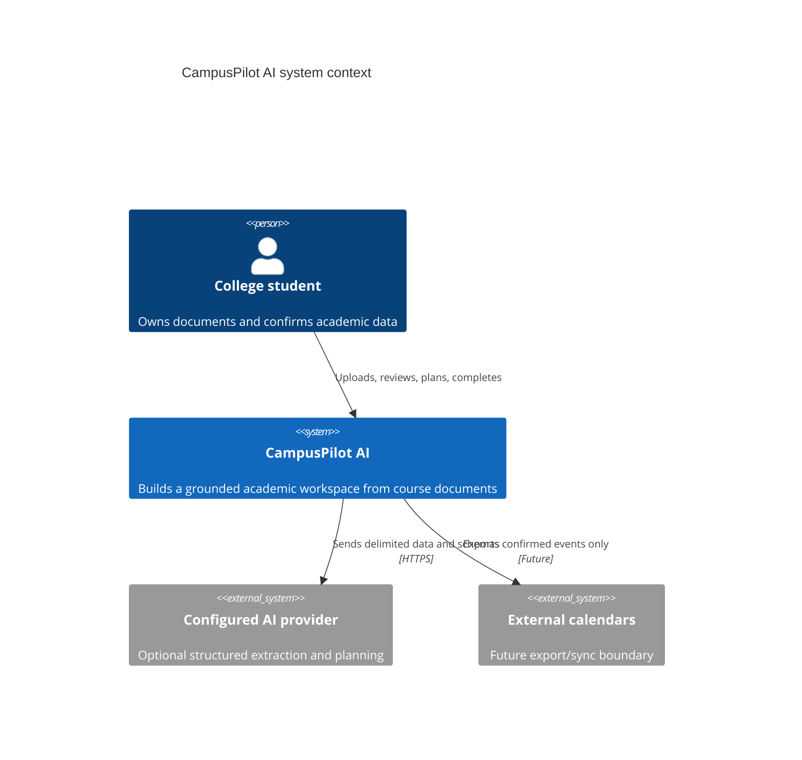
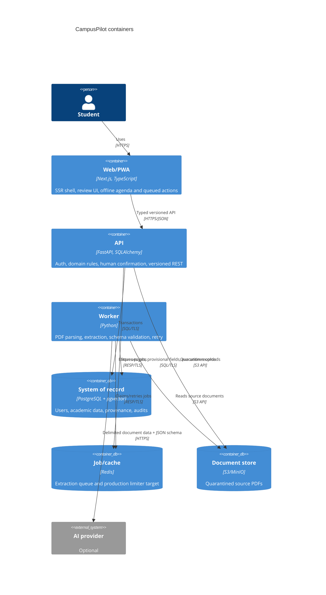
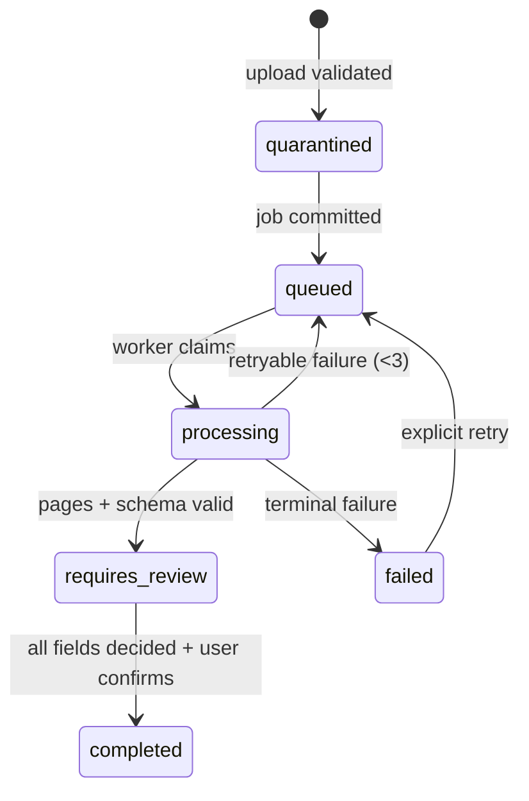

# Architecture

CampusPilot is a modular monolith. Domain boundaries live in one API codebase and share one PostgreSQL transaction boundary; document work runs in a separately deployable worker. This keeps operational complexity proportional to the product while allowing resource-heavy parsing and AI execution to scale independently.

## System context

## Containers

## Domain boundaries

| Domain                     | Owns                                                | Not allowed to do                           |
| -------------------------- | --------------------------------------------------- | ------------------------------------------- |
| `identity`                 | accounts, authentication, sessions                  | expose another user’s records               |
| `semesters`                | academic date frame                                 | infer canonical courses from raw AI output  |
| `courses`                  | confirmed course, meetings, instructors             | mutate provisional extraction               |
| `documents`                | upload validation, quarantine, pages                | execute or render active document content   |
| `extraction`               | jobs, grounded provisional fields, review decisions | write canonical data before confirmation    |
| `assignments` / `calendar` | confirmed work and calendar projection              | silently move confirmed events              |
| `study_plans`              | suggested plans and editable sessions               | delete/reschedule confirmed academic events |
| `progress`                 | actual completion                                   | present behavioral signals as grades        |
| `notifications`            | restrained user-facing alerts                       | send unbounded AI-originated text           |
| `analytics`                | aggregate planning signals                          | collect document contents                   |
| `ai`                       | provider contracts and schemas                      | let document text alter system behavior     |
| `audit`                    | append-only security/product decisions              | store secrets or full source documents      |

## Document state machine

Upload and planning requests accept idempotency keys. The database commit precedes queue publication so a temporary Redis failure leaves a discoverable queued job rather than losing source state. Workers short-circuit terminal jobs and replace provisional page/field results on retry.

## Canonical-data invariant

`ExtractedField` is never itself a course or deadline. It carries the proposed value, page, exact source reference, confidence, and a pending/accepted/rejected/edited decision. Confirmation creates canonical objects and attaches `source_field_id`; rejected fields are excluded.

## Deployment

The web, API, and worker images are independently deployable. The API and worker use the same package and schema migration. Horizontal API and worker scaling is safe once the production rate limiter is Redis-backed and workers use PostgreSQL row locking or a queue visibility-timeout implementation appropriate to the deployment platform.

Detailed tradeoffs are recorded in [docs/adr](docs/adr).
