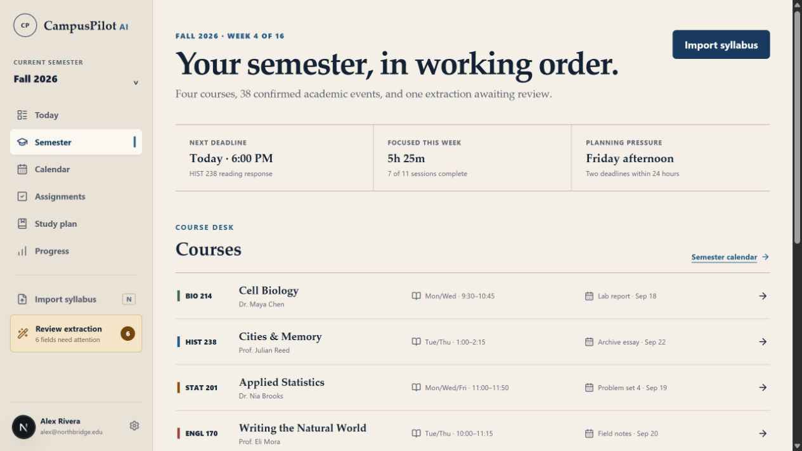
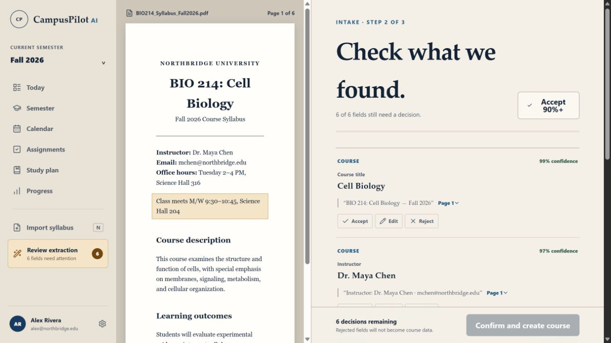
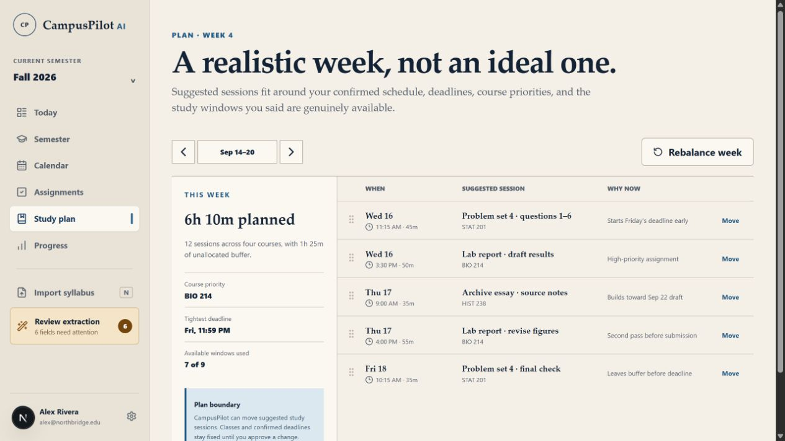

# CampusPilot AI

CampusPilot AI is a privacy-aware academic planning platform that turns syllabus PDFs into a structured, editable semester workspace. Extracted values retain their source page, evidence text, confidence, and review decision. AI proposes; the student confirms.

This repository is a **production-minded, portfolio-grade reference implementation**. It is not presented as a production deployment or a substitute for an institution's learning-management system.

## Overview

Students routinely translate inconsistent syllabi into calendars, reminders, and study plans by hand. CampusPilot models that work as an auditable workflow:

1. Create an account and semester.
2. Upload a syllabus PDF into quarantine.
3. Parse it asynchronously and validate structured extraction output.
4. Review proposed academic fields beside page-level evidence.
5. Accept, edit, or reject every consequential value.
6. Create canonical course records only from approved data.
7. Organize confirmed work into an agenda and editable study plan.

## Key Features

- Academic Editorial web experience across semester overview, upload, extraction review, courses, calendar, assignments, study planning, daily agenda, progress, and settings
- Versioned FastAPI surface for identity, semesters, courses, documents, extraction review, assignments, calendar, study plans, and progress
- Redis-backed document jobs with idempotent upload handling and bounded retries
- Local or S3-compatible quarantined object storage; MinIO is included for local development
- Grounded extraction fields with confidence, source page, evidence text, and explicit `pending`, `accepted`, `edited`, or `rejected` state
- Deterministic mock AI provider so extraction and planning can run without external credentials
- PWA shell caching and an IndexedDB queue for explicit low-risk offline completion intents
- Seeded synthetic demo workspace for interface review without real student data

## Product Tour

| Semester overview                                                   | Grounded extraction review                                                        |
| ------------------------------------------------------------------- | --------------------------------------------------------------------------------- |
|  |  |

| Semester calendar                                                   | Study planner                                                      |
| ------------------------------------------------------------------- | ------------------------------------------------------------------ |
|  |  |

## Architecture

```text
Next.js / strict TypeScript web + PWA
                 │ versioned JSON API
                 ▼
FastAPI / Pydantic / SQLAlchemy modular monolith
       │                 │                 │
       ▼                 ▼                 ▼
PostgreSQL          Redis job queue   S3 / MinIO quarantine
       ▲                 │
       └──── Python extraction worker ┘
```

PostgreSQL is the system of record. The development image includes pgvector and the migration enables its extension, but this release does not yet store embeddings or implement retrieval-augmented generation. Redis holds extraction jobs, and a separately deployable worker performs bounded PDF parsing and structured extraction. See [ARCHITECTURE.md](ARCHITECTURE.md) and the [architecture decisions](docs/adr).

## Technology Stack

| Layer         | Technology                                                                          |
| ------------- | ----------------------------------------------------------------------------------- |
| Web           | Next.js 16, React 19, TypeScript, service worker, IndexedDB, Zod                    |
| API           | FastAPI, Pydantic, SQLAlchemy asyncio, Alembic                                      |
| Worker        | Python, Redis, pypdf, the shared API/domain package                                 |
| Data          | PostgreSQL with pgvector available, Redis, S3-compatible storage / MinIO            |
| Security      | Argon2id, signed JWT sessions, double-submit CSRF, secure headers, Gitleaks, CodeQL |
| Observability | OpenTelemetry traces, Prometheus metrics, health/readiness endpoints                |
| Quality       | Pytest, Vitest, Playwright, axe-core, Ruff, mypy, ESLint, Prettier                  |

## AI Safety and Grounding

- Uploaded documents are delimited as untrusted data, never instructions.
- `AIProvider` defines extraction, study planning, summarization, and classification contracts.
- The real-provider adapter sends an explicit response schema and versioned prompt contract; returned data is validated with Pydantic.
- The deterministic mock provider is credential-free and testable.
- Extracted data remains provisional until every field receives a human decision.
- Canonical assignments and exams retain `source_field_id` provenance.
- Assignment dates are normalized only when a recognizable date falls inside the semester. Exams without an explicit time remain review data instead of receiving an invented timestamp.
- Committed synthetic evals measure required-field detection, deadline detection, grounding, and forbidden hallucinations, including a prompt-injection case.

## Security

Implemented controls include Argon2id password hashing, short-lived signed sessions, HttpOnly/SameSite cookies, double-submit CSRF on cookie-authenticated mutations, object-level ownership filters, input validation, PDF MIME/signature/size/page bounds, quarantine storage, rate limiting, structured AI schemas, security headers, and audit events.

The local limiter is intentionally process-local, and quarantine is not a substitute for production malware scanning. Deployment hardening and residual risks are documented in [SECURITY.md](SECURITY.md) and [docs/threat-model.md](docs/threat-model.md).

## Local Development

### Docker Compose

Requirements: Docker Desktop and GNU Make.

```bash
cp .env.example .env
make dev
```

Then open:

- Web: `http://localhost:3000`
- Development API documentation: `http://localhost:8000/api/docs`
- MinIO console: `http://localhost:9001`

Seed the synthetic demo account:

```bash
make seed
```

```text
Email: alex@northbridge.edu
Password: CampusPilotDemo!2026
```

These credentials are intentionally public demo data and must never be reused in another environment.

### Without Docker

```bash
pnpm install
python -m pip install -e "apps/api[dev]"
make api       # terminal 1
make worker    # terminal 2; requires Redis
make web       # terminal 3
```

When `CAMPUS_DATABASE_URL` is omitted, the API uses a local SQLite database for focused development and tests. PostgreSQL remains the integration and deployment target. To exercise the explicitly labeled front-end fallback without the API, start the web app with `NEXT_PUBLIC_DEMO_FALLBACK=true`.

## Testing

```bash
make verify
```

The repository includes:

- API, authorization, document-validation, extraction-schema, and deadline-normalization tests
- PostgreSQL and Redis integration tests activated by `TEST_POSTGRES_URL` and `TEST_REDIS_URL`
- Vitest component tests
- Playwright journey, accessibility, offline-shell, and responsive-overflow coverage
- Synthetic AI grounding and prompt-injection evals
- Dependency, secret, and CodeQL workflows

CI provisions PostgreSQL and Redis before running the integration suite. A local integration test that is skipped because its service URL is absent must not be represented as passing.

## Observability

- `/health/live` and database-backed `/health/ready` endpoints
- `/metrics` Prometheus export
- Document-processing duration, extraction failures, AI latency, AI schema failures, and worker queue-depth metrics
- OpenTelemetry instrumentation for FastAPI and SQLAlchemy with optional OTLP export
- Per-execution provider, model, prompt version, schema validity, request fingerprint, and latency metadata

Provider token counts and cost estimates are modeled but remain zero until a provider-specific adapter supplies trusted usage data. Proposed pilot SLOs are documented in [docs/slo.md](docs/slo.md); they are targets, not measured production claims.

## Known Limitations

- Image-only PDFs fail safely because a native OCR engine is not bundled yet.
- Production malware scanning and a reviewed document-retention/deletion policy are still required.
- The real-provider adapter targets a generic structured HTTP contract and needs provider-specific authentication, redaction, retry, quota, and usage-accounting policy.
- The web includes a clearly labeled synthetic demo workspace; several planning and reporting screens render seeded demo data rather than querying live API records.
- Ambiguous dates remain provisional. Assignments without a semester-valid date and exams without an explicit time are not made canonical.
- pgvector is enabled for future semantic retrieval but is not used by the current extraction path.
- Offline completion intents are retained locally, but automatic replay/conflict reconciliation is not implemented.
- Rate limiting is per-process; a multi-instance deployment should move it to Redis.
- Notification records exist, but email and push delivery are not connected to an external provider.
- External LMS and Google/Apple calendar synchronization are outside this release.

## Roadmap

The next production milestone is a limited university pilot: native OCR and malware scanning, a reviewed retention policy, complete live-data wiring for remaining web views, offline replay/conflict handling, provider-specific AI budgets and usage accounting, anonymized opt-in eval expansion, and external accessibility and penetration testing.

## Documentation

- [Product and information architecture](docs/product.md)
- [Implementation conventions](docs/architecture.md)
- [Threat model](docs/threat-model.md)
- [Operations runbook](docs/runbook.md)
- [Proposed SLOs](docs/slo.md)
- [Contributing](CONTRIBUTING.md)

## License

[MIT](LICENSE)
