# Product and information architecture

## Primary journey

```mermaid
flowchart LR
  A[Create semester] --> B[Upload syllabus]
  B --> C[Process pages]
  C --> D[Review grounded extraction]
  D --> E[Confirm course data]
  E --> F[See deadlines and conflicts]
  F --> G[Generate study plan]
  G --> H[Adjust sessions]
  H --> I[Execute daily agenda]
  I --> J[Review progress]
```

## Navigation model

- **Intake:** semester setup, documents, processing, extraction review
- **Semester:** overview, courses, calendar, assignments
- **Plan:** study planner, conflict resolution, workload view
- **Do:** today, individual study sessions, completion
- **Reflect:** progress, planning accuracy, settings, privacy and data controls

The default signed-in route is **Today**, because returning students primarily need to act. Intake status appears as an interrupt only when review is required.

## Critical objects

Documents and extraction jobs belong to intake; extracted fields are provisional editorial annotations. Courses, assignments, exams, readings, and meetings are canonical only after approval. Calendar events project confirmed academic objects. Study sessions are proposed, editable commitments that reference their academic reason.
